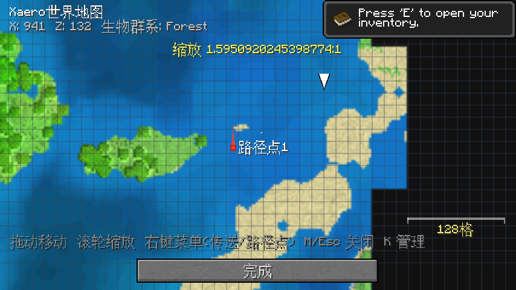
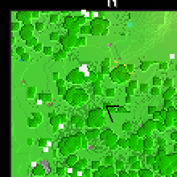
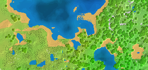

# Xaero 小地图 & 世界地图 — Minecraft Beta 1.7.3 移植版

> 把现代版 Xaero 的小地图 / 世界地图体验带回 **Beta 1.7.3**，基于自定义 **liber** 模组加载器（Mixin + EventBus）完全重写。



## 简介

本项目将 Xaero 风格的小地图与世界地图移植到 Beta 1.7.3。由于 b1.7.3 时代没有任何模组加载器，本项目运行在自研的 liber 加载器之上，通过运行时 Mixin 注入渲染钩子，全部逻辑用 Java 8 字节码编写，不修改原版任何类文件。

| | |
|---|---|
|  |  |

## 特性

### 小地图（HUD 左上角）
- 实时地形渲染，每区块瓦片缓存，真正的**群系染色**（加载原版自带却从未启用的 `misc/grasscolor.png` 染色板）
- 水深渐变、坡面阴影、细微确定性噪声细节（大片草地不再死平）
- 4 档视野缩放（64 / 128 / 256 / 512 格），方形 / 圆形切换
- 生物标记（红=敌对 / 浅灰=动物）、玩家白点 + 名字
- 坐标 / 群系文字显示

### 世界地图（M 键）
- 全屏浏览已探索区域，瓦片自动保存到 `xaero/worldmap/`，重进自动载入
- 滚轮平滑缩放（以光标为锚点），6 档比例（1px=8格 ~ 4px=1格），远景分级降采样
- **右键菜单：传送到此处 / 添加路径点 / 取消**（单人有效，自动落到目标点地表）
- 区块网格、自适应比例尺、路径点渐隐光柱、玩家离屏边缘箭头
- 瓦片后台线程读写、原子落盘，探索过程不掉帧

### 洞穴模式（C 键）
- 地下显示所在高度洞穴结构：黑=岩石 / 灰=洞底 / 橙=岩浆 / 蓝=水底 / 白点=矿石
- 引入真实光照：岩浆与火把会照亮周围洞穴（天空光 / 方块光取最大值）

### 路径点系统
- B 快速添加脚下路径点；世界地图内右键/B 在光标处创建
- K 打开管理器（传送 / 删除 / 改名）
- 死亡自动记录红色死亡点，方便找回装备

## 安装

1. 安装 PCL 或任意支持自定义版本的启动器
2. 把 `versions/liber/mods/` 里的两个 jar（`xaero-minimap`、`xaero-world-map`）放进版本 `mods` 目录
3. 需要 liber 加载器（见下方"构建"）以及你**自备**的 Beta 1.7.3 原版 jar（版权原因仓库不分发游戏本体）

> 整合包用户：将两个 jar 直接放入 `versions/liber/mods/` 即可，无需 Forge/ModLoader —— b1.7.3 没有模组API，liber 加载器直接完成类注入。

## 按键

| 键 | 功能 |
|---|---|
| 滚轮 | 缩放小地图 |
| M | 打开 / 关闭世界地图 |
| B | 快速路径点 |
| K | 路径点管理器 |
| O | 小地图设置 |
| C | 洞穴模式开关 |

聊天栏 / 界面打开时按键不会误触发。

## 从源码构建

```bat
javac --release 8 -cp b1.7.3.jar;lwjgl.jar;liber-loader-0.1.0.jar ^
      -d out src\minimap\*.java src\worldmap\*.java
```

- 所有模组类必须位于**默认包**（b1.7.3 的游戏类全在默认包，无法跨包引用）
- Mixin 写法：`@LiberMixin({"px"})` + `@Inject(method={"b(F)V"}, at=@At("RETURN"))`
- 源码位于 [`xaero-src/`](xaero-src/)，含完整测试（无头测试 / 地形巡检 / Mixin 注入模拟 / 字节码引用校验）

## 测试

```
字节码引用校验    ALL REFERENCES OK
Mixin 注入模拟    ALL PASS
无头功能测试      ALL PASS
地形专项巡检      ALL PASS（0.16 ms/区块）
真机端到端        PASS（自动建世界、传送巡检、四朝向截图）
```

E2E 驱动模组会自动创建世界、传送巡检多点位并截图比对，确保每次改动不回归。

## 已知限制

- 地表模式只显示已加载区块（未探索区域为深灰）
- 洞穴模式采样半径限制在玩家周围 8 区块
- 多人模式无法识别存档目录时按 seed 哈希命名数据

## 版权说明

- 本仓库代码为独立重写实现，仅供学习交流
- Xaero's Minimap / Xaero's World Map 原模组版权归其作者所有
- Minecraft 游戏本体版权归 Mojang 所有，仓库不分发任何游戏文件，游玩需拥有正版
